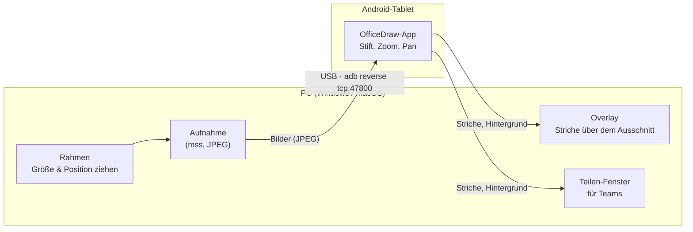

# OfficeDraw

**Mit dem Tablet-Stift live auf einen Bildschirmausschnitt deines PCs zeichnen, per USB und ohne Cloud.**

OfficeDraw streamt einen frei wählbaren Ausschnitt deines Windows- oder Mac-Bildschirms auf ein Android-Tablet. Dort zeichnest du mit dem Stift darauf, mit Zoom und Verschieben wie in einer Zeichen-App. Jeder Strich erscheint sofort über dem Ausschnitt am PC. Im Meeting teilst du einfach das Fenster „OfficeDraw – Ausschnitt“ in Teams, und alle sehen Bildschirm und Zeichnung zusammen.



## Funktionen

- **Ausschnitt wie bei einem Screen-Recorder:** Ein Rahmen liegt immer im Vordergrund. Du ziehst an Seiten und Ecken für die Größe und an der Leiste oben zum Verschieben. Alles innerhalb des Rahmens bleibt normal bedienbar.
- **Live-Zeichnen:** Striche mit Stiftdruck erscheinen während des Zeichnens am PC, nicht erst danach.
- **Intuitiv auf dem Tablet:**
  - Stift zeichnet, die Radierspitze radiert.
  - Ein Finger verschiebt, zwei Finger zoomen.
  - Die aufliegende Hand stört nicht (Palm Rejection).
- **Doppeltipp am Stift** wechselt zwischen Stift und Radierer. Getestet ist das mit dem HONOR Magic-Pencil, Stifte mit Android-14-Stylus-Tasten sollten ebenfalls funktionieren.
- **Whiteboard-Modus:** Hintergrund weiß oder schwarz statt Bildschirm, umschaltbar am PC und am Tablet.
- **Teams/Zoom/Meet:** Das Fenster „OfficeDraw – Ausschnitt“ zeigt Ausschnitt und Zeichnung zusammen und lässt sich als Fenster teilen.
- **Nur USB:** Die Verbindung läuft über `adb reverse`. Es gibt kein WLAN, keinen Server und kein Konto.

## Voraussetzungen

| | |
|---|---|
| **PC** | Windows 10 (2004+) oder macOS, [uv](https://docs.astral.sh/uv/) |
| **Tablet** | Android mit aktiviertem **USB-Debugging** (Einstellungen → Über das Tablet → 7× auf „Build-Nummer“ tippen → Entwickleroptionen → USB-Debugging) |
| **adb** | [Android SDK Platform-Tools](https://developer.android.com/tools/releases/platform-tools). OfficeDraw findet `adb` im `PATH` oder im Standardordner des Android SDK. |

## Schnellstart

```bash
# 1. Tablet per USB anschließen und den Debugging-Dialog auf dem Tablet bestätigen.

# 2. Tablet-App installieren (die APK ist im Python-Paket enthalten)
uvx --from "git+https://github.com/SeimSoft/OfficeDraw#subdirectory=python_app" officedraw install-app

# 3. OfficeDraw am PC starten
uvx --from "git+https://github.com/SeimSoft/OfficeDraw#subdirectory=python_app" officedraw
```

Dauerhaft installieren:

```bash
uv tool install "git+https://github.com/SeimSoft/OfficeDraw#subdirectory=python_app"
officedraw
```

Danach auf dem Tablet die App **OfficeDraw** öffnen. Sie verbindet sich automatisch, und der Punkt in der Rahmenleiste wird grün.

> **macOS:** Beim ersten Start fragt macOS nach der Berechtigung **Bildschirmaufnahme** für das Terminal (bzw. die App, aus der du `officedraw` startest). Ohne sie bleibt das Bild leer.

## Bedienung

### Am PC: der Rahmen

| Aktion | So geht's |
|---|---|
| Größe ändern | An einer Seite oder Ecke des Rahmens ziehen |
| Verschieben | An der dunklen Leiste oben ziehen |
| **Löschen** | Entfernt alle Stift-Anmerkungen, auch auf dem Tablet. Dort lassen sie sich mit „Rückgängig“ zurückholen. |
| **Weiß / Schwarz** | Hintergrund als Whiteboard. Ein zweiter Klick zeigt wieder den Bildschirm. |
| **Teilen** | Blendet das Fenster „OfficeDraw – Ausschnitt“ für Teams ein und aus |
| **×** | OfficeDraw beenden (oder Strg+C im Terminal) |

Optionen beim Start: `--fps 10` für mehr Bilder pro Sekunde (Standard 6), `--port` für einen anderen Port.

### Auf dem Tablet

| Eingabe | Wirkung |
|---|---|
| Stift | Zeichnen, mit Druckstärke |
| Radierspitze des Stifts oder Radierer-Werkzeug | Ganze Striche löschen |
| Doppeltipp am Stift | Zwischen Stift und Radierer wechseln |
| Ein Finger | Ansicht verschieben |
| Zwei Finger | Zoomen und verschieben |

Die Werkzeugleiste oben bietet Stift, Radierer, sechs Farben (inkl. Weiß), drei Strichstärken, Rückgängig, Alles löschen und Ansicht zurücksetzen. Rechts davon wählst du den Hintergrund: Bildschirm, Weiß oder Schwarz.

### In Teams teilen

1. In der Rahmenleiste auf **Teilen** klicken.
2. In Teams **Freigeben → Fenster → „OfficeDraw – Ausschnitt“** wählen.
3. Das Teilen-Fenster außerhalb des Rahmens platzieren, sonst nimmt der Ausschnitt es mit auf.

## Projektstruktur

```
officedraw_app/   Flutter-App (Android): Anzeige, Zoom/Pan, Stift-Eingabe
  lib/            Dart-Code (Verbindung, Protokoll, Zeichenmodell, Canvas)
  android/        u. a. MainActivity.kt für den Stift-Doppeltipp
python_app/       Desktop-Client (Windows/macOS), Paket „officedraw“
  src/officedraw/ Rahmen, Overlay, Teilen-Fenster, Aufnahme, USB-Server
  src/officedraw/bundled/officedraw.apk   mitgelieferte Tablet-App
```

### Protokoll

Eine TCP-Verbindung über `adb reverse` auf Port 47800. Jede Nachricht ist so aufgebaut: 1 Byte Typ, 4 Byte Länge (Big-Endian), danach die Nutzdaten.

| Typ | Richtung | Inhalt |
|---|---|---|
| `1` | PC → Tablet | JPEG-Bild des Ausschnitts |
| `2` | beide | JSON: `begin`/`pts`/`end` (Strich live), `remove`, `scene` (kompletter Stand), `bg` (Hintergrund) |

Koordinaten sind auf den Ausschnitt normiert (0…1). Deshalb passen die Striche auf jede Bildschirmgröße.

## Entwicklung

```bash
# Desktop-Client aus dem Quellcode
cd python_app && uv run officedraw

# Tablet-App direkt aufs Gerät
cd officedraw_app && flutter run

# Release-APK bauen und ins Python-Paket übernehmen
cd officedraw_app
flutter build apk --release --target-platform android-arm64
cp build/app/outputs/flutter-apk/app-release.apk ../python_app/src/officedraw/bundled/officedraw.apk

# Tests
cd officedraw_app && flutter analyze && flutter test
```

## Bekannte Grenzen

- **Windows** ist bisher nicht auf echter Hardware getestet. Entwickelt und getestet wurde mit macOS und einem HONOR-Tablet.
- Der Ausschnitt muss auf einem einzigen Bildschirm liegen.
- Größenänderungen strecken bereits gezeichnete Striche mit, weil sie relativ zum Ausschnitt gespeichert werden.
- Bilder werden als JPEG mit wenigen Bildern pro Sekunde übertragen, nicht als Video. Für Präsentationen reicht das gut, für Videos nicht.
- Die mitgelieferte APK ist mit dem Debug-Schlüssel signiert und nur für arm64 gebaut, was fast alle aktuellen Tablets abdeckt.
